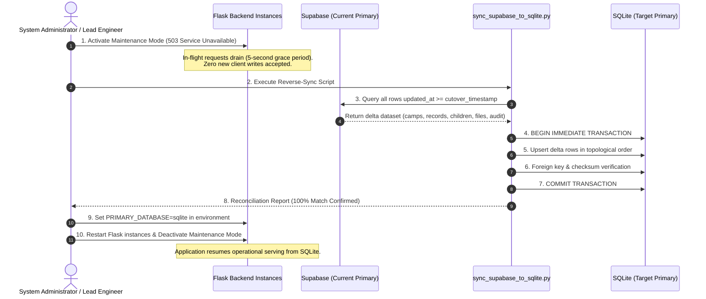

# Ink2Insights — Phase 1: Emergency Rollback & Reverse-Synchronization Protocol

**Document Version:** 1.0.0  
**Rollback Direction:** Supabase PostgreSQL → SQLite Primary Fallback  
**Scope:** Disaster Recovery & Operational Safety During the 48–72-Hour Cutover Window  
**Status:** Implementation Blueprint (Ready for Review)

---

## 1. Core Principle: No Blind Configuration Flipping

> [!CAUTION]
> Simply setting `PRIMARY_DATABASE=sqlite` without executing the reverse-synchronization protocol will cause catastrophic data loss for all new camps, patient records, clinical notes, and file associations created in Supabase during the cutover period.

Rollback is **only permitted** when accompanied by the formal reverse-synchronization procedure outlined in this document.

---

## 2. Emergency Rollback Triggers

An emergency rollback may only be declared under the following documented criteria:
1. **Extended Supabase Outage:** Sustained unavailability of the Supabase PostgreSQL API (>30 minutes) during active camp screening operations.
2. **PostgREST Bug / Data Corruption:** Systemic failure where writes appear successful but data integrity constraints or JSON parsing fail in PostgreSQL.
3. **Severe Network Degradation:** Latency from camp scanning devices to Supabase consistently exceeding 10 seconds per request, causing intake queues to fail.

---

## 3. Step-by-Step Rollback Execution Procedure



### Step 1: Write Freeze & Maintenance Mode
1. Admin triggers maintenance mode via environment flag or endpoint:
   `MAINTENANCE_MODE=true`
2. All non-health endpoints return HTTP 503 with a retry-after header.
3. In-flight requests are allowed 5 seconds to complete.

### Step 2: Change Detection & Delta Querying
The reverse-sync script (`scripts/sync_supabase_to_sqlite.py`) determines the exact cutover timestamp $T_{\text{cutover}}$ and executes delta queries against Supabase:
```sql
-- Retrieve all records modified since cutover
SELECT * FROM records 
WHERE updated_at >= :cutover_timestamp OR created_at >= :cutover_timestamp;

SELECT * FROM adult_records 
WHERE updated_at >= :cutover_timestamp OR created_at >= :cutover_timestamp;

SELECT * FROM paediatric_records 
WHERE updated_at >= :cutover_timestamp OR created_at >= :cutover_timestamp;

SELECT * FROM files 
WHERE created_at >= :cutover_timestamp;

SELECT * FROM record_audit_log 
WHERE created_at >= :cutover_timestamp;
```

### Step 3: Topologically Ordered SQLite Upsert
All fetched entities are upserted into SQLite within an atomic transaction:
1. `orgs` & `communities`
2. `camps` & `doctors`
3. `records`
4. `adult_records` & `paediatric_records`
5. `files` & `scan_hashes`
6. `record_audit_log` & `usage_ledger`

Because all primary keys are client-generated UUIDs (e.g. `rec_...`, `camp_...`), there are **zero primary key collisions** or auto-increment desynchronizations.

### Step 4: Cryptographic & Relational Validation
Before committing to SQLite:
1. **Row Count Check:** Verify that every record in Supabase exists in SQLite.
2. **Orphan Check:** Run SQLite integrity query:
   ```sql
   SELECT COUNT(*) FROM records WHERE camp_id NOT IN (SELECT id FROM camps);
   SELECT COUNT(*) FROM adult_records WHERE id NOT IN (SELECT id FROM records);
   SELECT COUNT(*) FROM paediatric_records WHERE id NOT IN (SELECT id FROM records);
   SELECT COUNT(*) FROM files WHERE record_id IS NOT NULL AND record_id NOT IN (SELECT id FROM records);
   ```
   If any orphan count $> 0$, the transaction rolls back immediately.
3. **Payload Checksum:** Compute SHA-256 canonical hash of the delta records and verify parity.

### Step 5: Environment Switch & Verification
1. Update `backend/.env`:
   ```bash
   PRIMARY_DATABASE=sqlite
   ENABLE_SQLITE_SHADOW_WRITE=false
   ```
2. Restart backend service.
3. Verify that `/api/records` and `/api/camps/<camp_id>/export` load correctly and return complete data.
4. Disable maintenance mode.

---

## 4. Recovery from Interrupted / Partial Synchronization

If `sync_supabase_to_sqlite.py` crashes or is interrupted mid-execution:
1. **Atomic Transaction Protection:** The script wraps all upserts in a single SQLite transaction (`BEGIN IMMEDIATE ... COMMIT`). If interrupted, SQLite automatically rolls back to the pre-script state.
2. **Idempotent Re-execution:** The script is completely idempotent (`INSERT OR REPLACE INTO`). Re-running the script from the beginning is safe and will not produce duplicate records or partial state.

---

## 5. Conditions Under Which Rollback MUST BE REFUSED

Rollback is **strictly prohibited** and must be refused by the engineering team if any of the following occur:
1. **Unresolvable Foreign Key Orphanage:** Clinical records were written in Supabase with invalid `camp_id` or `community_id` values that do not exist in SQLite and cannot be traced.
2. **Corrupted Clinical JSON:** Record payloads in Supabase contain malformed JSON that cannot be parsed by Python's `json.loads` or inserted into SQLite.
3. **Local Storage Exhaustion:** Insufficient local disk space on the host machine to store the incoming delta and associated file previews.
4. **Active Forensic Investigation:** If the cloud failure is due to a security incident or suspected breach, rollback without forensic authorization is prohibited.
